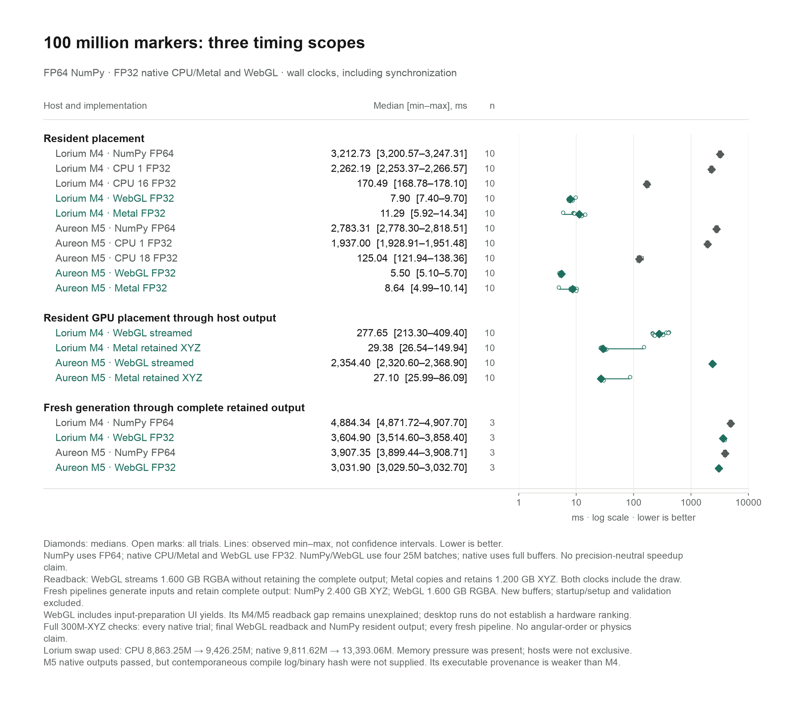

# Validated 100M placement measurements



The repaired WebGL test runs 100 million markers in four 25-million-marker texture batches on Lorium (M4 Max) and Aureon (M5 Max). The report retains FP64 NumPy, native FP32 single-worker and multicore CPU, native Metal, and WebGL results. Exact medians, observed ranges and all timing samples are available in [plot-data.json](plot-data.json) and [exact-values.csv](exact-values.csv). The lines are observed ranges, not confidence intervals.

## Timing scopes

1. **Resident placement:** inputs and output storage already exist. CPU clocks include materializing the output; GPU clocks end after synchronized execution. NumPy also copies each batch result into the complete resident output. Three warmups precede ten measured placements.
2. **Resident GPU placement through host output:** a continuous clock includes placement and full host retrieval. WebGL streams 1,600,126,976 bytes of RGBA32F, including padding, without retaining the complete result simultaneously. Native Metal copies and retains 1,200,000,000 bytes of XYZ FP32. Ten observations are retained for each implementation.
3. **Fresh generation through complete retained output:** three independent application pipelines start with fresh input generation, allocate buffers/textures and finish with the complete output retained in host memory. NumPy retains 2,400,000,000 bytes of XYZ FP64; WebGL retains 1,600,126,976 bytes of RGBA32F. WebGL input preparation includes UI yields. These clocks exclude process/browser startup, imports or source loading, GPU context/shader setup, reference validation and result serialization. No stage medians are added to create a pipeline timing.

NumPy and WebGL use four 25M batches; the native implementation uses full buffers and a persistent CPU worker pool with 4,096-marker work chunks. Precision, output format, execution API and validation cadence differ. The report does not assert a precision-neutral speedup or a hardware ranking.

## Validation and provenance

All 300 million XYZ coordinates are checked against the original-input FP64 placement reference for every native timed trial, the final WebGL full-readback output, the final NumPy resident output and every fresh pipeline output. Finite values, coverage, assigned bands and coordinate tolerance are required. Native single-worker and multicore CPU outputs are bit-identical. NumPy uses an independent algebraic FP64 oracle. Validation occurs outside the measured intervals; intermediate NumPy/WebGL resident trials are not each independently validated.

The exact source-result hashes, paths, pass assertions, timing sample locations, versions, output byte counts and implementation scopes are locked in [manifest.json](manifest.json). M4 and M5 NumPy runner/engine hashes match; NumPy is 2.5.4 on both, with Python 3.12.16 on M4 and 3.12.11 on M5. M5 resident WebGL used the v2 page and M4 the v3 page; their resident runtime function hashes match. The v3 page adds the separate fresh-output pipeline. Detailed execution and audit receipts belong in [provenance/](provenance/).

M5 native source/shader hashes, fixture hashes, result artifact and reproduction commands were independently checked. A contemporaneous compile log and binary hash tying that exact M5 executable to the recorded source were not supplied. Its numerical outputs are validated, but its executable provenance is weaker than M4's independently checked source-to-binary-to-fixtures-to-output chain. The recorded M5 compile command is a reproduction recipe, not a verified historical compile log.

Lorium had pre-existing desktop memory pressure. During its NumPy run, reported swap used changed from 8,863.25M to 9,426.25M and system memory-free percentage from 44% to 39%; during the later native run, swap used changed from 9,811.62M to 13,393.06M. These observations do not isolate the benchmark's contribution to system-wide changes. Hosts were not exclusive. The large WebGL streamed-readback difference between the desktop runs remains unexplained.

## Preserved historical baselines

- [Native 10M placement](historical-native-10m.png): historical FP32 CPU single-worker, multicore and Metal resident execution, with all 30 timed outputs fully validated on each host. It is a separate size and experiment.
- [Synthetic raw-data detector](historical-raw-detector.png): historical raw-window FP64 recomputation, compiled full/incremental CPU, Rust incremental and Metal incremental fitted-detector measurements, with batch 1,024. Each mark is one of five trial medians. This workload includes feature state, learned scoring, guards and alerts; its timings are separate from sphere placement.

The historical aggregates preserve numerical samples, validation outcomes and original artifact hashes in [sources/](sources/). Private Aquila source and original materials are not included. The synthetic detector histories are not efficacy evidence. No Rust sphere-placement implementation exists in this benchmark, and these tests do not establish angular ordering or physics properties.

## Regeneration

From the repository root, check all source hashes, assertions, sample counts and expected rows without plotting:

```sh
python3 tools/report_xl.py reports/2026-11-14-xl/manifest.json \
  --output reports/2026-11-14-xl --check-only
```

Render with the recorded plotting dependencies in an isolated uv environment:

```sh
uv run --no-project --python 3.12 \
  --with matplotlib==3.11.2 --with pillow==13.0.0 \
  python tools/report_xl.py reports/2026-11-14-xl/manifest.json \
  --output reports/2026-11-14-xl
```

The renderer uses Arial when available, then Helvetica, Inter, Liberation Sans or DejaVu Sans. It exports SVG, 2× PNG, delivery-size PNG, grayscale QA PNG, an HTML value table, CSV, JSON, visual specifications and a render receipt. Export versions and actual font are recorded. Font availability and SVG timestamps can change artifact hashes without changing the measured evidence.

Regeneration leaves the render receipt pending visual inspection. Review the delivery-size color and grayscale figures, confirm their values and scope labels against the sources, and record the outcome in `qa-final.json`. Do not treat successful plotting alone as visual or scientific QA.
